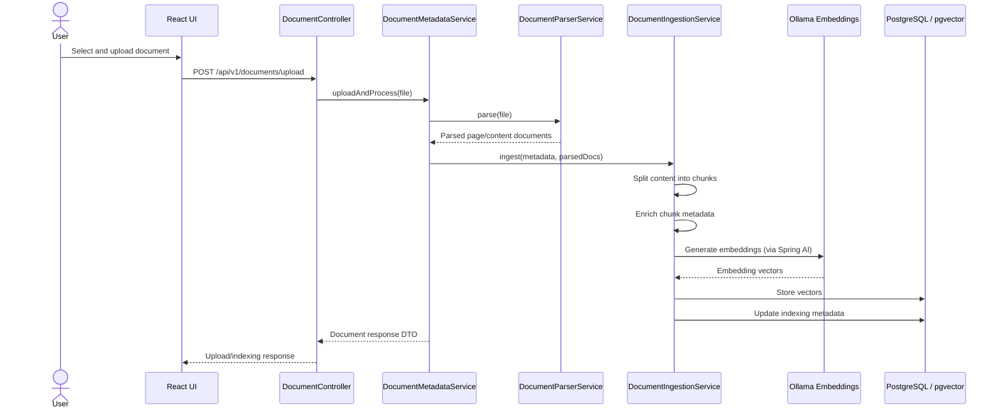
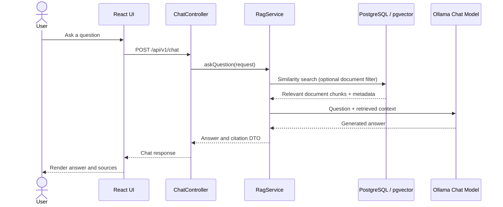

# DocMindAI — Architecture Notes

## 1. System context

DocMindAI is a browser-based document question-answering system. The React client communicates with a Spring Boot API. The backend coordinates document parsing, chunking, embedding generation, vector retrieval, and LLM response generation. PostgreSQL stores document metadata and pgvector embeddings; Ollama serves the configured chat and embedding models.

## 2. Main components

| Component | Responsibility |
|---|---|
| React application | Document upload/listing, chat interaction, API calls, answer and source rendering |
| `DocumentController` | HTTP endpoints for upload, list, get, and delete operations |
| `ChatController` | HTTP endpoints for RAG chat, SSE response streaming, and similarity search |
| `DocumentMetadataService` | Coordinates document metadata lifecycle and ingestion |
| `DocumentParserService` | Reads PDF pages and parses generic files through Tika |
| `DocumentIngestionService` | Splits parsed content, enriches chunk metadata, and writes vectors |
| `RagService` | Performs similarity retrieval and builds model-backed responses |
| `DocumentMetadataRepo` | Persists document metadata using Spring Data JPA |
| Spring AI `VectorStore` | Writes and searches embedding records in pgvector |
| Ollama | Hosts the configured chat and embedding models locally |
| PostgreSQL + pgvector | Stores metadata and vector representations for semantic search |

## 3. Document ingestion sequence

## 4. RAG question-answering sequence

## 5. Data model and vector metadata

The relational `DocumentMetadata` entity tracks uploaded-document information and processing status. The ingestion pipeline adds metadata to each vector chunk, including:

- `documentId` — UUID of the source document.
- `fileName` — original uploaded filename.
- `contentType` — detected/request content type.
- `chunkIndex` — position of the chunk in the processed sequence.
- `pageNumber` — page metadata when provided by the parser.

The configured vector store uses the `vector_store` table, the HNSW index type, cosine distance, and 1024 dimensions. The dimension must match the embedding model output.

## 6. API surface

All endpoints are currently rooted at `/api/v1`.

### Documents

- `POST /documents/upload`
- `POST /documents/upload-multiple`
- `GET /documents`
- `GET /documents/{id}`
- `DELETE /documents/{id}`

### Chat and search

- `POST /chat`
- `POST /chat/stream` — backend SSE endpoint
- `POST /chat/search/similarity`

See controller and DTO classes for exact request and response schemas.

## 7. Current implementation boundaries

- The supplied Compose file provisions PostgreSQL with pgvector; it does not containerize the frontend, backend, or Ollama.
- The application uses a development Spring profile and development database defaults.
- JWT-related configuration is present, but this source snapshot does not implement a complete Spring Security authentication and authorization flow.
- The backend defines an SSE endpoint; the supplied React API service uses the standard chat endpoint, so end-to-end streaming should be treated as pending until verified.
- Metadata and vector-store operations span different persistence mechanisms. Failure handling and consistency need explicit integration tests and a deliberate transaction/compensation strategy.

## 8. Recommended next engineering steps

1. Add integration tests for successful ingestion and each failure point in parsing, embedding, and vector persistence.
2. Ensure document deletion cannot silently leave orphaned vectors.
3. Define a consistent failure/retry strategy for metadata and vector-store updates.
4. Add Spring Security authentication and per-document authorization before multi-user deployment.
5. Connect the React chat UI to SSE and test disconnect/error handling.
6. Externalize API URLs, database credentials, model names, and secrets.
7. Add CI for backend tests, frontend lint/build, and container image creation.
